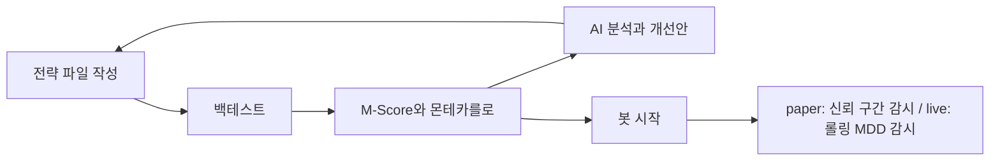
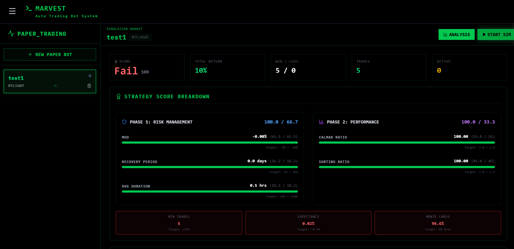

<div align="center">

# Marvest

**암호화폐 자동매매 전략을 백테스트, AI 분석, 몬테카를로 시뮬레이션으로 점검하는 플랫폼.**


</div>

Freqtrade 백테스트 엔진, Google Gemini 기반 전략 분석, 몬테카를로 시뮬레이션을 한 웹 화면에서 쓰도록 묶은 프로젝트다. 전략을 점수로 평가하고, 개선안을 받고, 봇을 시작하고, 실행 중인 봇의 위험 지표를 확인하는 흐름을 지원한다.

> 본 프로젝트는 교육 및 실험 목적이다. 점수와 AI 분석 결과는 투자 권유가 아니다. 투자 결과에 대한 책임은 사용자에게 있다.

## 목차

- [기능](#기능)
- [동작 방식](#동작-방식)
- [빠른 시작](#빠른-시작)
- [사용 흐름](#사용-흐름)
- [설정](#설정)
- [배포](#배포)
- [한계](#한계)
- [내부 구조](#내부-구조)
- [개발](#개발)

## 기능

| 기능 | 내용 |
| --- | --- |
| 전략 백테스트 | `user_data/strategies/`의 전략 파일로 Freqtrade 백테스트를 실행하고 결과를 `/api/backtest`로 조회한다. |
| M-Score 등급 | 리스크 지표(1단계, 가중치 0.667)와 성과 지표(2단계, 가중치 0.333)를 합산해 점수 90 이상 S, 80 이상 A, 70 이상 B, 그 아래는 C 등급을 매긴다. 1단계 점수 60 미만, 거래 150회 미만, 평균 수익(기대값) 0.5% 미만, 몬테카를로 파산 확률 0 초과 중 하나라도 해당하면 `Fail`로 판정한다. |
| 몬테카를로 시뮬레이션 | 거래 기록을 복원 추출해 5,000회 시뮬레이션한다. 자산이 원금의 50% 아래로 떨어지는 비율을 파산 확률로 계산하고, 2.5~97.5 백분위로 95% 구간을 낸다. |
| AI 전략 분석 | Gemini 2.5 Flash가 백테스트 통계와 전략 소스를 함께 보고 취약점과 개선안을 제시한다 (`/api/ai/analyze`). |
| AI 개선 코드 생성 | 선택한 개선안을 적용한 새 버전 전략 파일을 생성한다 (`/api/ai/apply`). 생성된 코드는 사용자가 검토해야 한다. |
| 봇 실행과 감시 | Freqtrade 프로세스를 시작하고 멈추고 상태를 조회한다. paper 모드 봇은 몬테카를로 신뢰 구간 이탈을, live 모드 봇은 최근 30거래 기준 롤링 MDD(몬테카를로 `worst_mdd`와 비교)를 분석 결과로 제공한다. |
| OTP 로그인 | 사용자 ID와 TOTP 코드로 로그인한다 (`/api/auth/login`). 발급한 토큰을 백엔드가 검사하지 않아 API 자체는 보호되지 않는다. [한계](#한계) 참고. |

## 동작 방식



백엔드(FastAPI)가 Freqtrade 실행, 결과 파일 조회, Gemini 호출, 봇 프로세스 관리를 맡는다. 프론트엔드(React, Vite)는 빌드 결과를 백엔드가 정적 파일로 서빙한다. 데이터와 설정은 `user_data/` 폴더에 파일로 저장한다.



## 빠른 시작

### 요구 환경

- Python 3.10 (Dockerfile 기준)
- Node.js 20 이상 (Docker 빌드 기준)
- TA-Lib C 라이브러리 (0.4.0, 빌드 방법은 Dockerfile 참고). `pip install`의 `TA-Lib` 패키지가 이 라이브러리를 먼저 요구한다.
- Freqtrade는 `requirements.txt`로 venv에 설치된다.
- `user_data/config.json` (백테스트가 이 파일을 쓴다)
- Google Gemini API 키 ([Google AI Studio](https://aistudio.google.com/app/apikey)에서 발급)

### 로컬 실행

1. 저장소를 클론하고 `.env` 파일을 만든다. 값은 [설정](#설정)을 참고한다.

```bash
git clone https://github.com/mmm-labs-kr/marvest-trading-system.git
cd marvest-trading-system
cp .env.example .env
```

2. 백엔드를 실행한다.

```bash
cd backend
python -m venv venv
source venv/bin/activate        # Windows: venv\Scripts\activate
pip install -r requirements.txt
uvicorn app.main:app --reload
```

3. 저장소 루트에서 프론트엔드 개발 서버를 실행한다. Vite가 `/api` 요청을 `localhost:8000`으로 넘긴다.

```bash
cd frontend
npm install
npm run dev
```

### Docker 실행

먼저 위 1단계처럼 `.env`를 만든다. `docker-compose.yml`이 `.env`를 필수로 읽는다.

```bash
docker network create proxy-network
docker compose up -d --build
```

`docker-compose.yml`은 외부 네트워크 `proxy-network`을 요구한다. 컨테이너는 8000 포트를 `expose`만 하고 호스트에 게시하지 않는다. 외부 접근 경로(리버스 프록시 등)는 이 레포에 없다. 아래 "미확인·제외" 참고.

## 사용 흐름

1. `user_data/strategies/`에 Freqtrade 전략 파일(`.py`)을 작성한다. 예시는 `vwma_v3.py`(1시간봉)다.
2. 웹 화면에서 전략을 골라 백테스트를 실행한다 (`POST /api/backtest/run`).
3. 결과의 M-Score 등급과 몬테카를로 파산 확률을 확인한다.
4. AI 분석을 요청해 취약점과 개선안을 받는다 (`POST /api/ai/analyze`).
5. 적용할 개선안을 고르면 새 전략 버전이 생성된다 (`POST /api/ai/apply`). 코드를 검토한 뒤 사용한다.
6. 봇을 만들고 시작한다 (`POST /api/trading/bots`, `POST /api/trading/start`).
7. 봇 분석 화면에서 paper 모드는 신뢰 구간 이탈을, live 모드는 롤링 MDD를 확인한다 (`GET /api/trading/analysis/{bot_id}`).

## 설정

설정은 `.env` 파일에서 읽는다. 예시는 `.env.example`에 있다. 실제 키와 시크릿은 커밋하지 않는다.

| 키 | 필수 | 의미 |
| --- | --- | --- |
| `GOOGLE_API_KEY` | AI 기능 사용 시 | Gemini API 키. 없으면 AI 엔드포인트가 비활성으로 응답한다. |
| `OTP_SECRET_JS` | 로그인 사용 시 | 첫 번째 사용자용 TOTP 시크릿 (16~32자 무작위 문자열). |
| `OTP_SECRET_SB` | 로그인 사용 시 | 두 번째 사용자용 TOTP 시크릿. |
| `ALLOWED_ORIGINS` | 아니오 | CORS 허용 오리진. 쉼표로 구분한다. 기본값은 `*`다. |
| `DEBUG` | 아니오 | `true`면 예외 상세를 API 응답에 포함한다. |

주의할 점:

- `GOOGLE_API_KEY`, OTP 시크릿, Freqtrade 설정 파일의 거래소 키와 API 비밀번호는 저장소에 넣지 않는다.
- 백테스트는 요청에서 기간을 받지 않고 `user_data/config.json` 설정을 쓴다.
- 몬테카를로와 롤링 MDD 계산은 과거 거래 기록을 전제로 한다. 거래 기록이 적으면 결과의 신뢰도가 낮다.

## 배포

`main` 브랜치에 push하면 `.github/workflows/deploy.yml`이 실행된다. 워크플로는 필요한 파일을 압축해 SSH로 서버에 올리고, 서버에서 `docker compose up -d --build`를 실행한다. 사용하는 GitHub Secrets 이름은 `HOST`, `USERNAME`, `SSH_KEY`다. 워크플로는 `user_data/`를 압축에 넣지 않으므로 서버에 `user_data/`(설정, 전략, 데이터)가 미리 있어야 한다. 서버 종류와 외부 접근 구성은 레포에서 확인할 수 없다.

## 한계

- **API 인증이 없다.** 로그인은 토큰을 발급하지만 백엔드는 그 토큰을 검사하지 않아 API가 인증 없이 열려 있다(`backend/app/api/endpoints/auth.py:21-36`). 화면 진입만 프론트엔드가 막는다. 이 상태로 공개 배포하지 마라. 로컬이나 닫힌 네트워크에서만 쓴다.
- 실거래 운용 성과 자료는 레포에 없다. 전략의 실전 검증 결과는 이 README로 판단할 수 없다.
- 백테스트 결과는 과거 데이터에 대한 결과다. 미래 수익을 보장하지 않는다.
- AI가 제안한 개선 코드는 검증 없이 쓰면 안 된다. 생성 결과를 백테스트로 다시 확인해야 한다.
- 몬테카를로는 거래 순서를 섞어 얻은 분포다. 시장 구조 변화는 반영하지 못한다.
- 봇 제어는 로컬 프로세스 기준이다. 서버 재시작 후 상태 복구 동작은 확인하지 않았다.
- 테스트 코드는 레포에 없다. 인증 없는 개발용 엔드포인트 `/api/trading/test/*`(가짜 거래 추가, 거래 삭제)가 코드에 남아 있다.

<details>
<summary>미확인·제외</summary>

미확인:

- 운영 서버의 종류와 외부 접근 구성.
- 리버스 프록시와 `proxy-network` 구성 방법.
- 프론트엔드 화면에서 각 기능이 실제로 동작하는지 브라우저로 확인한 기록은 없다.
- Freqtrade 버전이 고정돼 있지 않아 최신 버전이 Python 3.10에서 동작하는지 확인하지 않았다.

제외:

- 서버 재시작 후 봇 상태 복구는 지원 범위에 두지 않았다.

</details>

## 내부 구조

<details>
<summary>폴더 구조와 주요 모듈</summary>

```
marvest-trading-system/
├── backend/
│   ├── app/
│   │   ├── main.py              # FastAPI 앱, 예외 처리기, CORS, 정적 파일 서빙
│   │   ├── schemas/backtest.py  # 백테스트 요청, 점수 스키마
│   │   ├── core/
│   │   │   ├── config.py        # 경로, 환경 변수 로드
│   │   │   └── exceptions.py    # MarvestException
│   │   └── api/endpoints/
│   │       ├── auth.py          # OTP 로그인
│   │       ├── backtest.py      # 백테스트 실행, 결과 조회
│   │       ├── monte_carlo.py   # 몬테카를로 시뮬레이션
│   │       ├── score_calculator.py  # M-Score 계산
│   │       ├── ai_feedback.py   # Gemini 분석, 개선 코드 생성
│   │       ├── trading.py       # 봇 관리, 시작과 중지, 분석
│   │       └── configs.py       # 설정 파일과 전략 파일 관리
│   └── requirements.txt
├── frontend/                    # React 19, Vite, Tailwind CSS, Recharts
├── user_data/                   # Freqtrade 데이터, 전략, 결과 파일
├── Dockerfile                   # 프론트엔드 빌드 후 백엔드 이미지에 복사
├── docker-compose.yml
└── .github/workflows/deploy.yml
```

- 백엔드 라우터: `/api/configs`, `/api/backtest`, `/api/trading`, `/api/auth`, `/api/ai`
- 프론트엔드 화면: 로그인, 전략 편집기, 백테스트 목록과 상세, 몬테카를로, AI 피드백, 모의 투자, 실전 투자

</details>

## 개발

- 백엔드 실행: `cd backend && uvicorn app.main:app --reload`
- 프론트엔드 개발 서버: `cd frontend && npm run dev`
- 프론트엔드 린트: `cd frontend && npm run lint`
- 프론트엔드 빌드: `cd frontend && npm run build`

## 라이선스

레포에 LICENSE 파일이 없다. 사용 조건은 정해지지 않았다.
